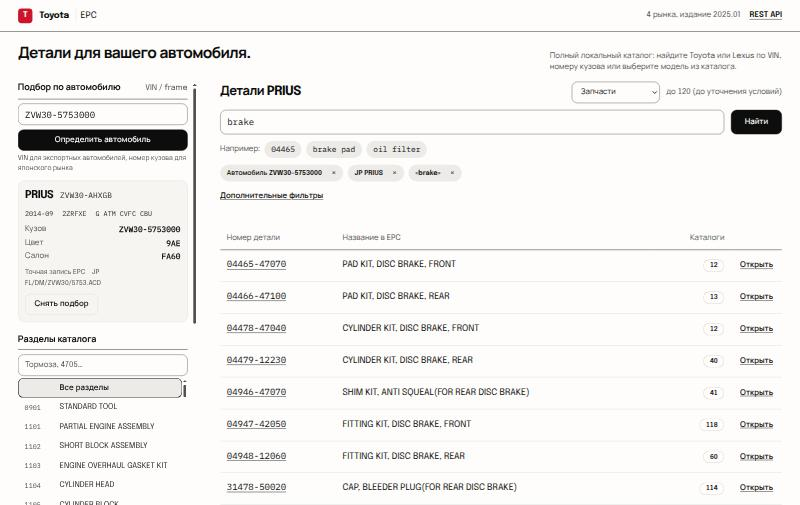

# Toyota EPC

Веб-сервис для электронного каталога запчастей Toyota и Lexus, построенный на данных ПК-версии EPC 2025.01.
Установщик из `Toyota_EPC_2025_01.iso` распаковывается без запуска, бинарные таблицы EPC разбираются,
по ним строится поисковый индекс SQLite, поверх которого работают REST API и веб-интерфейс.
Внешних каталожных API нет: все ответы берутся из локальных файлов.



## Возможности

- Все четыре рынка издания: EU, GR, JP, US — 1 429 каталогов Toyota и Lexus.
- Поиск по номеру детали (с дефисами и без), по его началу и по английскому названию.
- Подбор по 17-символьному VIN и японскому номеру кузова с проверкой месяца выпуска, группы EPC,
  характеристик комплектации (KPT/KIG) и диапазонов кузовов (KRK).
- Разделы каталога, миниатюры и полноразмерные схемы, декодированные из CCITT Group 4.
- Карточка детали: названия, каталоги, условия применения, связанные номера, справочная цена JP.
- Аксессуары JPIO с фильтрами по модели, автомобилю и месяцу.
- Происхождение каждой записи: исходный файл, SHA-256, смещение и сырые байты.

| Данные | Количество |
|---|---:|
| Каталоги | 1 429 |
| Уникальные номера деталей | 3 039 582 |
| Записи деталей (HNB) | 27 548 638 |
| Связи номер — каталог — раздел | 10 719 442 |
| Конфигурации моделей | 288 078 |
| Записи автомобилей (FL) | 256 487 118 |
| Аксессуары | 35 079 |

## Быстрый старт

Нужен Python 3.11+. Если индекс уже собран (`data/full.sqlite` и `data/full/app/epcdata`):

```bash
make install
make run
```

Интерфейс — <http://127.0.0.1:8000>, Swagger — <http://127.0.0.1:8000/docs>.

Через Docker (каталог `data/` монтируется только на чтение):

```bash
docker compose up --build
```

## Подготовка данных

Нужны `7z` и upstream-сборка `innoextract` с поддержкой Inno Setup 6.3. Скрипт собирает её из зафиксированной
ревизии и сверяет SHA-256 архива:

```bash
sudo apt-get install 7zip build-essential cmake curl python3-venv \
  libboost-all-dev liblzma-dev libbz2-dev zlib1g-dev
bash scripts/build_innoextract.sh
make extract
make import
```

`make extract` кладёт `app/epcdata` в `data/full` (около 33 ГиБ). `make import` строит индекс `data/full.sqlite`
(около 1,5 ГиБ) примерно за минуту. Индекс собирается во временный файл и атомарно заменяет предыдущий,
поэтому ошибка не портит рабочую базу. После пересборки сервер нужно перезапустить.

Пути можно переопределить переменными `EPC_DATABASE` и `EPC_SOURCE_ROOT`.

## Устройство

```text
Toyota_EPC_2025_01.iso
  └─ epc.extract    7z + innoextract           → data/full/app/epcdata
       └─ epc.importer   таблицы поиска, FTS5     → data/full.sqlite
            └─ epc.api        FastAPI + статика   → REST API и интерфейс
```

Большие таблицы EPC не копируются в SQLite. В индекс попадают только справочники, связи номер — каталог — раздел
и полнотекстовый поиск. Записи деталей, условия, автомобили и схемы читаются из исходных файлов бинарным поиском
через `mmap`: файлы отсортированы по ключу, а блоки автомобилей разложены по кузову и серии.
Поэтому сборка индекса занимает минуту, а не часы.

| Модуль | Назначение |
|---|---|
| `epc/layout.py` | Раскладка бинарных записей, XOR, CP932 и месяцы |
| `epc/records.py` | Нарезка записей и бинарный поиск по отсортированным файлам |
| `epc/native.py` | Чтение исходных файлов EPC с кэшами |
| `epc/importer.py` | Сборка индекса SQLite |
| `epc/services/` | Поиск, подбор по VIN, проверка применяемости, аксессуары |
| `epc/api/` | Роуты FastAPI, зависимости и схемы ответов |
| `epc/static/` | Интерфейс на ES-модулях без сборки |

Описание форматов файлов — в [docs/FORMAT.md](docs/FORMAT.md).

## REST API

Префикс `/api/v1`, все методы `GET`. Списки возвращают `items`, `total`, `limit`, `offset`, `has_more`;
`limit` от 1 до 100. Ошибки: 404 — нет сущности, 422 — неверные параметры, 503 — индекс не собран.
Каталог идентифицируется как `EU:101510`: коды повторяются между рынками, и неоднозначный код без рынка даёт 422.

| URL | Назначение |
|---|---|
| `/health`, `/stats` | Готовность и объём данных |
| `/catalogs?region=JP&q=prius` | Каталоги |
| `/catalogs/{code}/variants` | Конфигурации и двигатели |
| `/catalogs/{code}/figures` | Разделы |
| `/catalogs/{code}/figures/{figure}/images` | Иллюстрации раздела |
| `/catalogs/{code}/diagrams/{image}.png` | Полноразмерная схема |
| `/vehicles/resolve?identifier=ZVW30-5753000` | Автомобиль по VIN или номеру кузова |
| `/parts?q=04465&vehicle=ZVW30-5753000` | Поиск деталей с фильтрами |
| `/parts/{number}` | Карточка детали |
| `/parts/{number}/applications` | Условия применения |
| `/applications/{region}:{catalog}:{offset}` | Исходная запись HNB |
| `/accessories?q=floor+mat` | Аксессуары JPIO |
| `/sources`, `/import-issues` | Исходные файлы и особенности данных |

```bash
curl 'http://127.0.0.1:8000/api/v1/vehicles/resolve?identifier=ZVW30-5753000'
curl 'http://127.0.0.1:8000/api/v1/parts?vehicle=ZVW30-5753000&q=04465'
```

У `/parts` есть фильтры `region`, `catalog_code`, `figure_code`, `pnc`, `model`, `engine`, `production_month`.
Если задан автомобиль или месяц, условия EPC проверяются по исходным записям; в этом случае `total` — верхняя
граница (`total_is_estimate: true`), а следующую страницу нужно запрашивать по `next_offset`.

## Подбор по VIN

Номер кузова `ZVW30-5753000` — реальная запись: Prius `ZVW30-AHXGB`, 2014-09, цвет `9AE`, салон `FA60`;
для `04465` подбор возвращает `04465-47070`.

`resolution: exact` означает, что найдена запись автомобиля и совпали модель, месяц и группа EPC.
Полный VIN в файлах EPC не хранится, поэтому контрольная цифра и модельный год отдельно не проверяются.
Если найден только префикс, API возвращает `catalog_candidates` и не подставляет выдуманные дату и комплектацию.

## Скорость

Запросы по настоящему HTTP на localhost, 20 повторов, прогретый кэш ([отчёт](docs/benchmark.json)):

| Запрос | p50 | p95 |
|---|---:|---:|
| Начало номера | 2,2 мс | 2,5 мс |
| Название `brake pad` | 8,8 мс | 9,1 мс |
| Номер кузова | 1,8 мс | 2,2 мс |
| VIN | 1,6 мс | 2,3 мс |
| Детали для автомобиля | 7,4 мс | 8,6 мс |
| Схема из кэша | 1,0 мс | 1,1 мс |

```bash
make benchmark
```

## Разработка

```bash
make check
```

Запускает `ruff` (линтер и форматирование), `mypy --strict` и 71 тест. Тесты не требуют ISO: они собирают
синтетический набор файлов EPC и проверяют индексацию, поиск, подбор по VIN, правила применяемости,
декодирование схем, происхождение записей, обработку ошибок и атомарность сборки.
